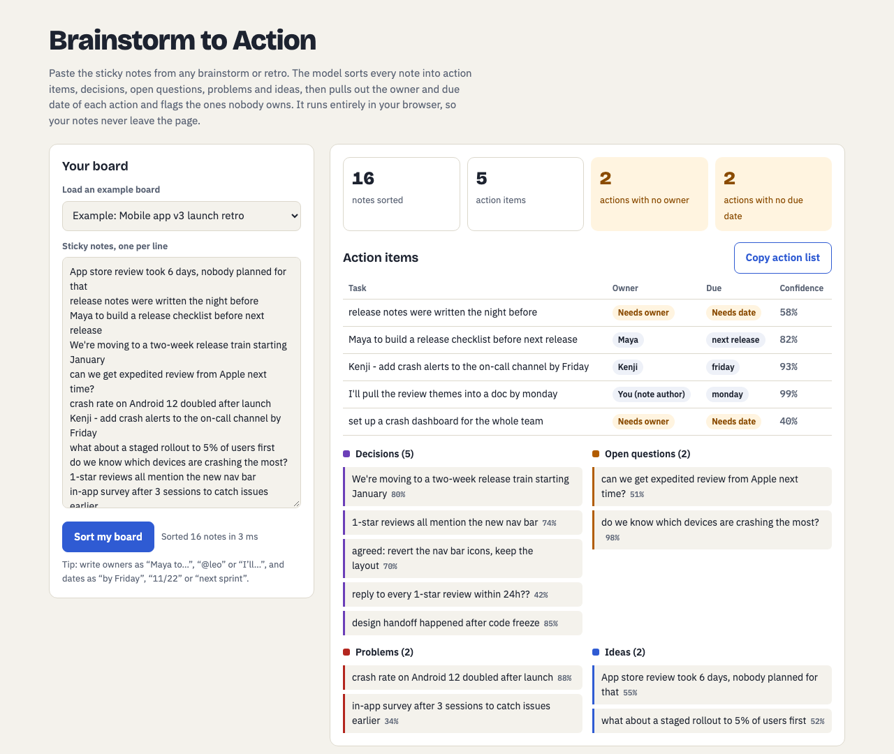
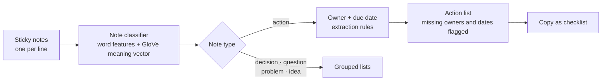
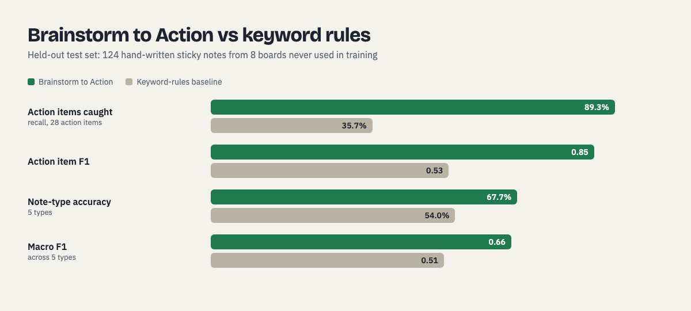

# Brainstorm to Action

**Turns a messy brainstorm board into a clean, owned action list in milliseconds, right in the browser.**


**[Try the live demo](https://vidhi20.github.io/Brainstorm-to-Action/web/)** · [Product brief (PRD)](docs/PRD.md) · [Eval results](eval/results.json)

<picture>
  <source media="(prefers-color-scheme: dark)" srcset="docs/images/app-dark.png">
  
</picture>

## The problem

Every team runs brainstorms and retros on digital whiteboards. The meeting ends with 50 sticky notes, and the follow-through dies there: nobody knows which notes were decisions, which were tasks, or who owns them.

## What it does

Brainstorm to Action reads every sticky note and:

1. Sorts it into **action item, decision, open question, problem or idea**
2. Pulls out the **owner** ("Maya to…", "@leo", "I'll…") and **due date** ("by Friday", "11/22", "next sprint") of every action item
3. **Flags action items with no owner or no date**, so they get assigned before the meeting ends
4. Exports the action list as a checklist you can paste into Slack, Jira or a doc

It runs entirely in the browser: no server, no API key, $0 per board, and notes never leave the user's device.



## Results (held-out test set)

Tested on **124 hand-written sticky notes from 8 boards** (launch retro, pricing workshop, AI feature brainstorm, B2B onboarding retro, hackathon planning, churn deep dive, team offsite, search quality). None of these boards or topics were used for training.



| Metric | Brainstorm to Action | Keyword-rules baseline |
|---|---|---|
| Action items caught (recall) | **89.3%** (25 of 28) | 35.7% |
| Notes flagged as actions that really are actions (precision) | **80.6%** | 100% |
| Action item F1 | **0.85** | 0.53 |
| Owner **and** due date both right, end to end | **89.3%** (25 of 28) | n/a |
| Owner extraction / due-date extraction on true action items | **100% / 100%** | n/a |
| Overall note-type accuracy (5 types) | **67.7%** | 54.0% |
| Macro F1 across 5 types | **0.66** | 0.51 |
| Time to sort a 16-note board in the browser | **about 3 ms** for the first sort, including rendering; **under 0.1 ms** once warmed up | n/a |

Per type F1: question 0.93, action 0.85, problem 0.64, decision 0.45, idea 0.44. Browser timing was measured in Chrome on an Apple M4 laptop.

**Weak spots, found by the eval:**
- Ideas vs decisions: both are often written as short statements ("Team plan becomes the default" vs "three plans max"). This is the main v2 target.
- Automatic theme grouping (clustering notes by topic) averaged an adjusted Rand index of only 0.02 on the test boards. That is not good enough to show users, so **it was cut from v1** (see the [PRD](docs/PRD.md)).

Full numbers: `eval/results.json`. Re-run: `python3 eval/run_eval.py`. Browser parity check: `node eval/parity.js` (same numbers as Python).

## How it works

- **Note classifier:** logistic regression over word and word-pair features plus a 50-dimension meaning vector per note (pretrained GloVe word vectors, weighted toward rare, topic-carrying words). Exported to JSON and run in plain JavaScript.
- **Owner and date extraction:** rules for the ways people actually write owners and dates on sticky notes; normalized output ("fri" becomes "friday", "Dec 10th" becomes "dec 10").
- **Training data:** 3,704 generated notes from 220 template boards, plus 179 hand-written natural notes from 11 boards (checkout sprint, campaign brainstorm, advisory board, remote-work retro, data migration, holiday sale, design system, partner integrations, support retro, outage postmortem, newsletter relaunch).
- **Model selection:** leave-one-board-out cross-validation on the natural training boards only. Adding natural notes lifted cross-validated macro F1 from 0.45 to 0.69, which is why they are weighted 15x.

## Product decisions

- **Runs in the browser, no LLM call.** $0 per board, no data leaves the device, results in milliseconds. Trade-off: lower accuracy on ambiguous notes than a large language model.
- **Action items first.** The model is strongest exactly where the value is: action items (F1 0.85) and owner and date (25 of 28 fully right).
- **Theme grouping cut from v1.** Showing wrong groups would erode trust, so people keep grouping by hand until a model clears the bar.
- **Confidence shown on every note,** so users can spot and fix low-confidence calls.

## Honest notes on the evaluation

- All boards (training and test) were written by the project author; they are realistic but not collected from real teams. The next step is a test on real exported boards.
- The test set was scored twice: once with a template-only model (59% accuracy, which exposed the gap) and once with the final model. The author saw the first run's errors before writing the natural training notes. Test labels were never changed and test notes were never used for training.

## Run it

```bash
pip install -r requirements.txt
python3 data/make_train.py   # generate the template training boards
python3 b2a/train.py         # train and select the model (needs the 50d GloVe vectors at /tmp/glove50.gz)
python3 eval/run_eval.py     # score the held-out test boards
```

Or just open `web/index.html` in any browser: the model is built in.

## Repo layout

```
data/   make_train.py (template boards), train_natural.txt, test_boards.txt (held out)
b2a/    pipeline.py (inference), train.py (training and model selection), model.json, vectors.npz
eval/   run_eval.py, parity.js, results.json
web/    engine.js (browser port), template.html, index.html (self-contained demo)
docs/   PRD.md, images/
```

## Credits

GloVe word vectors: Pennington, Socher and Manning, "GloVe: Global Vectors for Word Representation", EMNLP 2014.

## Author

Vidhi Parekh · [LinkedIn](https://www.linkedin.com/in/vidhi-parekh) · [GitHub](https://github.com/vidhi20) · [Portfolio](https://vidhiparekh.com)
